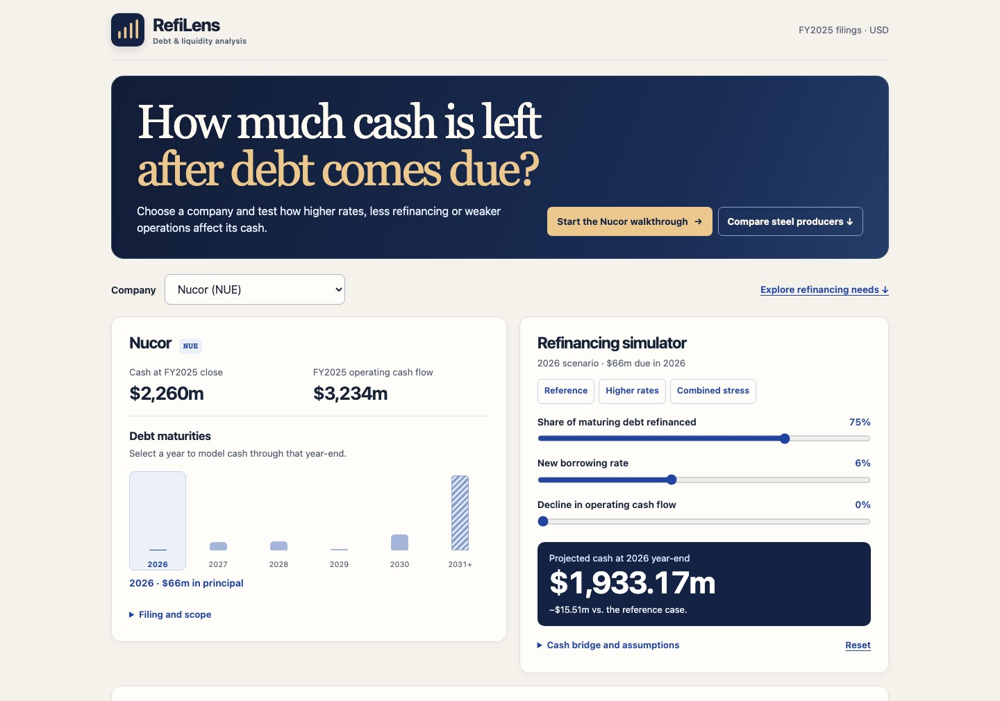

# RefiLens

**Corporate refinancing and liquidity simulator**

[Open the simulator](https://refilens.pages.dev/) · [Follow the Nucor walkthrough](https://refilens.pages.dev/#nucor-walkthrough) · [Compare Nucor and Steel Dynamics](https://refilens.pages.dev/#steel-comparison)

How much cash can a company keep when its debt comes due? RefiLens uses FY2025 SEC filings from five U.S. industrial companies to show how changes in operating cash flow, borrowing rates and the share of debt refinanced affect year-end cash.

[](https://refilens.pages.dev/)

## Try the public simulator

1. **Select a company and a maturity year.** The chart shows disclosed principal due by year. The selection sets how far the cash projection runs.
2. **Change the financing assumptions.** Adjust how much debt is refinanced, the new interest rate or the cash the business generates. The projected cash chart compares your scenario with a reference case and explains the difference.
3. **Set a cash reserve.** The sensitivity table shows the lowest year-end cash under different combinations. The model calculates the smallest whole refinancing percentage that meets your reserve at each year-end through the selected year.

The [Nucor walkthrough](https://refilens.pages.dev/#nucor-walkthrough) applies four scenarios in order and explains each result as the controls change.

## Nucor and Steel Dynamics under the same stress

Nucor starts with nearly three times as much cash as Steel Dynamics. In the **Combined stress** scenario, both companies generate 20% less operating cash and refinance half of their maturing principal at 10%. Their starting positions reverse by the end of 2027.

| USD millions | Nucor | Steel Dynamics |
|---|---:|---:|
| Cash at FY2025 close | 2,260.00 | 769.88 |
| Modeled operating cash after capital spending, 2026–27 | −1,669.60 | 423.20 |
| Projected cash at 2027 close | 162.76 | 996.00 |

Under these assumptions, Nucor draws on opening cash to cover capital spending while Steel Dynamics generates cash after investing. Open **How each cash balance adds up** to see how principal payments and interest contribute to both outcomes. [Explore the comparison](https://refilens.pages.dev/#steel-comparison)

## Data and model

The simulator covers Nucor, Steel Dynamics, Reliance, Lincoln Electric and Illinois Tool Works. Historical figures share a calendar FY2025 reporting period and USD denomination. Each figure is tied to its original filing, and grouped later maturities stay together. [Coverage and selection criteria](docs/COVERAGE_EXPANSION.md) · [Data provenance](docs/DATA_PROVENANCE.md)

The public scenarios repeat FY2025 capital spending and make borrowing terms and operating cash assumptions explicit. They model annual closing balances and exclude dividends, buybacks and acquisitions. The extended Nucor research case includes additional assumptions and cash uses. [Financial methodology](docs/FINANCIAL_METHODOLOGY.md) · [Extended case memo](docs/case-studies/NUCOR_FY2025.md)

## How it runs

| Component | Implementation |
|---|---|
| Public simulator | `site/` runs the shared Python `Decimal` cash model in a Pyodide web worker on Cloudflare Pages. The build bundles the FY2025 snapshots and the four shared peer scenarios. |
| Local research workspace | `apps/web/` provides a Next.js and TypeScript interface. `services/api/` contains FastAPI, SQLAlchemy, the SEC import tools and the shared financial model. |
| Evidence and reproducibility | `fixtures/` contains filing snapshots. `scripts/` contains setup, checks and export tools. `docs/` contains the financial definitions, source evidence and validation results. |

[Architecture](docs/ARCHITECTURE.md) · [Public build and deployment](docs/PUBLICATION.md) · [Documentation index](docs/README.md)

## Run the research workspace locally

The local workspace requires Python 3.12+, Node 22+ and pnpm. Run these commands from the repository root.

```sh
./scripts/setup.sh
./scripts/dev.sh
```

Open the [local workspace](http://localhost:3000) or [API documentation](http://127.0.0.1:8000/docs). Setup loads authentic offline filing snapshots into SQLite.

[Local workspace guide](docs/LOCAL_WORKSPACE.md) · [Validation report](docs/VALIDATION_REPORT.md) · [Contribution guide](CONTRIBUTING.md)

[](https://github.com/GinesN/RefiLens/actions/workflows/ci.yml)
